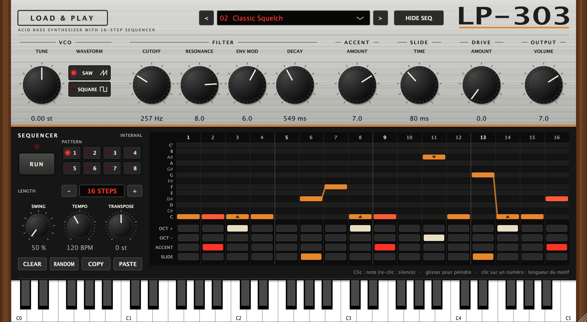

# LP-303 — Load & Play

Basse « acide » monophonique dans l'esprit de la TB-303, avec son séquenceur 16 pas
intégré. C'est le troisième instrument Load & Play, après LP-60 et Model Play.



Le son tient en une voix : un oscillateur dents de scie ou carré, un filtre passe-bas à
diodes résonant, un ampli, un accent, un slide, et une saturation en option. Le
séquenceur joue 8 motifs de 16 pas, calés sur le tempo et la lecture de l'hôte.

## Formats et compatibilité

| Format | Logiciels | Installé dans |
|---|---|---|
| AU | Logic Pro, GarageBand, MainStage, Reaper, Ableton Live | `~/Library/Audio/Plug-Ins/Components` |
| VST3 | Cubase, Ableton Live 10+, Studio One, Bitwig, Reaper, FL Studio, Grid Play | `~/Library/Audio/Plug-Ins/VST3` |
| CLAP | Bitwig 4.3+, Reaper 6.71+, FL Studio 2024+ | `~/Library/Audio/Plug-Ins/CLAP` |
| LV2 | Ardour, Carla, Linux / Raspberry Pi | `~/Library/Audio/Plug-Ins/LV2` |
| Appli autonome | sans DAW | `build/LP303_artefacts/Release/Standalone/LP-303.app` |

Sur Mac, les binaires sont universels (Apple Silicon + Intel), à partir de macOS 10.13.
Windows et Linux (x64 et ARM64) se compilent avec le même code, automatiquement sur GitHub
(`../.github/workflows/plugins.yml`, avec les autres plugins Load & Play) ou à la main avec CMake.

## Compiler

Il faut CMake 3.22 ou plus récent, Ninja et un compilateur C++17 (Command Line Tools
d'Apple sur Mac, Visual Studio 2022 sous Windows, GCC ou Clang sous Linux avec les paquets
listés dans `../.github/workflows/plugins.yml`). En local, `JUCE` et `clap-juce-extensions` sont des liens vers
ceux de `../MiniMoog/` ; sinon CMake les télécharge aux mêmes versions.

```bash
cmake -S . -B build -G Ninja -DCMAKE_BUILD_TYPE=Release
cmake --build build
```

Le plugin AU, VST3 et LV2 est copié automatiquement dans `~/Library/Audio/Plug-Ins`
(option `-DLP303_INSTALL_PLUGINS=OFF` pour ne pas le faire). Pour une compilation plus
rapide sur un Mac Apple Silicon, `-DCMAKE_OSX_ARCHITECTURES=arm64` ne construit que
l'architecture de la machine.

Tests :

```bash
./build/RenderTest_artefacts/Release/RenderTest demo.wav   # filtre, slide, accent, séquenceur, démo WAV
./build/RenderTest_artefacts/Release/RenderTest --bench    # charge processeur
auval -v aumu L303 LdPl                                     # validation Apple de l'Audio Unit (une fois installée)
```

Avec `-DLP303_SNAPSHOT=ON`, l'outil `Snapshot` enregistre une capture de l'interface
(`Snapshot interface.png 1`) et vérifie le plugin entier (`Snapshot --selftest` : presets,
séquenceur sur l'horloge interne, transposition au clavier, lecteur de fichier MIDI, sauvegarde des motifs, séquenceur replié). `Snapshot compact.png 1 compact` capture la fenêtre séquenceur replié.

## Organisation

| Fichier | Rôle |
|---|---|
| `Source/AcidEngine.h` | Le son : tables d'onde, filtre à diodes, enveloppes, accent, slide, saturation. |
| `Source/Sequencer.h` | Les motifs (sans verrou entre l'interface et l'audio) et le séquenceur calé sur l'hôte. |
| `Source/Presets.h` | Sons d'usine, motifs d'usine, motif au hasard. |
| `Source/MidiFilePlayer.h` | Lecteur de fichier MIDI glissé sur la fenêtre (repris de LP-60 et Model Play). |
| `Source/PluginProcessor.*` | Paramètres, MIDI, tempo et lecture de l'hôte ou horloge interne, sauvegarde. |
| `Source/PluginEditor.*` | Façade : panneau d'alu pour le son, grille du séquenceur, clavier. |
| `Tests/RenderTest.cpp` | Contrôles automatiques et rendu d'une démo. |
| `Tests/Snapshot.cpp` | Capture de l'interface et test du plugin entier. |

## Le son

- **VCO** : dents de scie ou carré. Le carré penche légèrement, comme celui de la machine
  d'origine, qui sort d'un transistor. **TUNE** accorde de -12 à +12 demi-tons.
  L'oscillateur lit des tables d'onde à bande limitée (une par octave) : aucune harmonique
  ne se replie, même dans les notes aiguës.
- **FILTER** : passe-bas à diodes, 4 pôles. Les condensateurs de l'échelle à diodes se
  chargent les uns les autres ; les pôles s'étalent et la pente sous la coupure ressemble
  à celle d'un 3 pôles (18 dB/oct), d'où le son « caoutchouc ». Saturation tanh entre
  chaque étage, résolue sans retard (zero-delay feedback), en suréchantillonnage x4.
  - **CUTOFF** : de 60 Hz à 7,7 kHz ;
  - **RESONANCE** : jusqu'à 90 % du seuil d'auto-oscillation. Le filtre chante fort mais
    ne siffle pas tout seul, et la résonance creuse les graves comme sur l'original ;
  - **ENV MOD** : l'enveloppe ajoute jusqu'à 4,5 octaves et abaisse un peu le point de départ ;
  - **DECAY** : décroissance de l'enveloppe du filtre, de 0,2 à 2,5 s.
- **ACCENT** : sur une note accentuée, le volume monte (jusqu'à +6 dB), le filtre reçoit
  plus de signal, l'enveloppe du filtre prend sa décroissance la plus courte, et un « coup »
  de cutoff passe par un condensateur qui s'accumule d'un accent à l'autre. Plus la
  résonance est haute, plus ce coup est lent et marqué (le « wow » des lignes acides).
- **SLIDE** : sur des notes liées, la hauteur glisse (courbe exponentielle) en 20 à 500 ms
  (80 ms par défaut), sans redéclencher les enveloppes.
- **DRIVE** : saturation douce et asymétrique après l'ampli, niveau compensé. À 0, elle est coupée.
- **OUTPUT** : volume.

## Jouer au clavier

- Une note liée (jouée avant de relâcher la précédente) **glisse** : c'est le slide.
- Une vélocité de **100 ou plus** donne un **accent**.
- Priorité à la dernière note ; en relâchant, on revient en glissant à la note encore tenue.
- La molette de pitch bend couvre ±2 demi-tons.
- Glissez un fichier .mid sur la fenêtre : un petit lecteur apparaît (lecture, retour au début, boucle,
  tempo) et LP-303 joue le fichier comme au clavier.

## Le séquenceur

- **8 motifs** de 16 pas, chacun avec sa longueur (1 à 16 pas, boutons `-` / `+` ou clic sur
  un numéro de pas).
- Chaque pas : une note (do à do aigu, sur la grille), **OCT +** / **OCT -**, **ACCENT**,
  **SLIDE**, ou un silence (re-cliquer sur la note). On peut peindre en glissant.
- Doubles croches calées sur le tempo et la position de l'hôte : le motif reste en place
  quand on boucle, qu'on saute dans le morceau ou qu'on démarre en milieu de mesure.
- Une note dure une demi double croche ; un slide tient la porte ouverte jusqu'au pas
  suivant et y glisse.
- **SWING** : de droit (50 %) à shuffle marqué (75 %).
- Un changement de **PATTERN** attend la fin du motif en cours (le point orange indique le
  motif qui joue).
- **RUN** : dans un DAW, le séquenceur joue quand l'hôte est en lecture (« SYNC HOST ») ;
  en appli autonome, RUN lance l'horloge interne au tempo du réglage **TEMPO** (« INTERNAL »).
- Pendant la lecture, une touche du clavier **transpose** le motif (do 3 = pas de
  transposition) ; le réglage **TRANSPOSE** la garde en mémoire.
- **CLEAR**, **RANDOM** (motif acide au hasard), **COPY** / **PASTE** d'un motif à l'autre.
- **HIDE SEQ** (en haut, à droite des presets) replie le séquenceur quand LP-303 est joué en MIDI depuis
  le logiciel : la fenêtre ne garde que le son et le clavier. **SHOW SEQ** le fait revenir ; replié mais en
  marche, le bouton s'allume en orange.
- Les motifs, et l'état du séquenceur (affiché ou replié), sont sauvegardés avec le projet.

## Presets et motifs d'usine

Sons : Init, Classic Squelch, Rubber Square, Deep Sub, Screamer, Distorted Acid, Wah Tone,
Plucky, Long Slide, Acid Lead. Un preset ne touche qu'au son : les motifs, le tempo et le
séquenceur restent tels quels.

Motifs (écrits pour LP-303) : Acid Roll, Squelch, Slide Walk, Hypno 12 (12 pas), Offbeat
Pump, Minor Run, Bounce, Sparse Wow (8 pas).

## Ce que vérifient les tests

- **Filtre stable** à résonance maximale : filtre seul au-delà du seuil d'oscillation avec
  une entrée énorme, puis moteur complet (toutes les notes, coupure balayée, accent et env
  mod au maximum, avec et sans drive) à 44,1, 48 et 96 kHz : jamais de NaN, crêtes bornées.
- **Pas de repliement ni de sous-harmonique** : notes de 55 à 1 760 Hz, résonance au
  maximum, accent ou non, en dents de scie et en carré : aucun pic hors des harmoniques
  au-dessus de -50 dB.
- **Slide** : la hauteur glisse puis arrive sur la note, sans redéclencher l'enveloppe ;
  une note détachée saute et redéclenche.
- **Accent** : plus fort (+7 dB), coupure plus haute, son plus brillant, décroissance
  courte ; seuil exact à la vélocité 100.
- **Séquenceur** : chaque pas tombe à l'échantillon près (blocs de tailles variables),
  durée des notes, slide en legato, silences, accent, longueur de motif, départ en milieu
  de mesure à 140 BPM, swing, boucle de l'hôte sans note bloquée, changement de motif en
  fin de cycle, arrêt du transport.
- **Motifs** : lecture des motifs d'usine, sauvegarde et relecture à l'identique.

## Licence

GNU AGPL v3 (voir `LICENSE`). TB-303 est une marque de Roland Corporation, citée
seulement pour décrire l'inspiration sonore : Load & Play n'est pas affilié à Roland.
Le nom, la façade, les presets et les motifs de LP-303 sont originaux.
